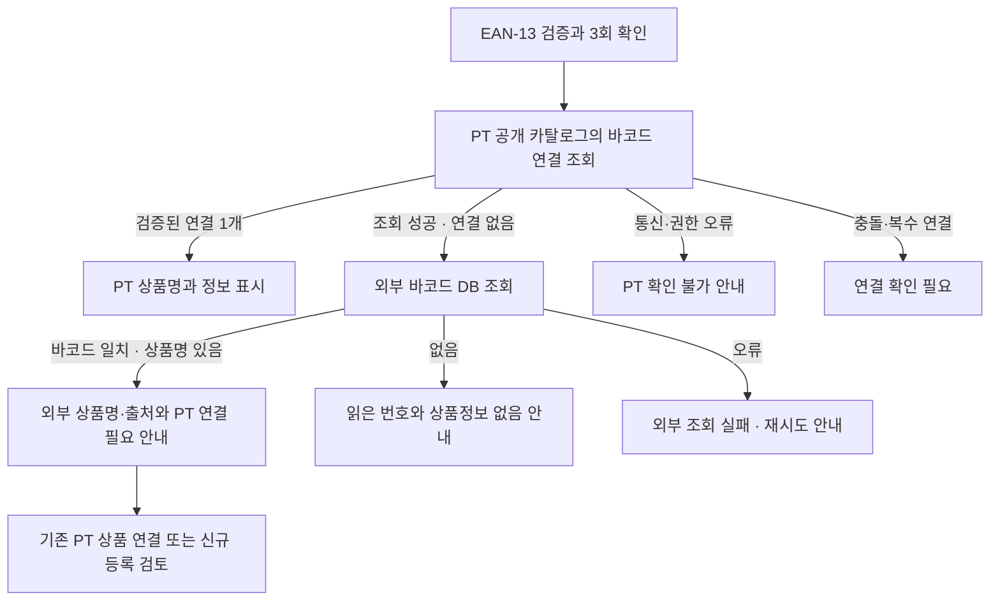

# 바코드 기반 외부 상품 검색과 PriceTrace 연결 도입 보고서

작성일: **2026-10-26 KST**, 정정·구현 확인: **2026-10-27 KST**. 현재 브랜치: `feat/barcode-online-lookup`.

구현 기준: `c8147a1` — v5 독립 상품 인식과 소실 복구. 이 소스에 대한 전달 전 EditMode 재검증은 **105/105 PASS**이며 [검증 요약](validation/branch-delivery-2026-10-26.json)에 기록했다.

초기 보고서의 도입 제안을 [온라인 조회](ONLINE-LOOKUP.md)로 구현했다. 최종 소스 `389f9e9`, EditMode 162/162 PASS와 아래 읽기 확인을 근거로 정정한다. 이 작업에서 PT DB 쓰기·함수 배포는 하지 않았다. 2026-10-27 초반 바코드 함수는 **404/PGRST202**였으나 **00:27 이후 A25·PC에서 200/matched**로 확인했다. 공개 카탈로그 v4는 publishable key/anon으로 **200·107개 상품**, 테아닌 PT ID 존재를 확인했다. 사용자 제공 전일 결과는 200·102개이며 시점을 구분한다.

## 1. 결론과 지금 할 일

**바코드 인식 → 외부 상품 검색 → 상품명 표시 → PT 연결 상태 안내는 도입할 수 있다.** 현재 앱의 바코드 판독을 유지하고 상품 조회 계층을 추가하는 방식이 적절하다.

먼저 실제 사용할 제품 **10~20개**로 외부 API의 바코드 조회율과 상품명·브랜드·규격의 일치 여부를 확인한다. 이 수량은 제안하는 실험 규모이며 측정 결과가 아니다. 공개 API가 존재한다는 사실만으로 국내 식품·건강기능식품 전체를 찾을 수 있다고 보장하지 않는다.

PT에도 바코드 연결을 두는 것이 맞다. 다만 바코드는 **기존 PT 상품 ID에 연결하는 식별자**로 관리한다. 외부 상품명이나 검색 순위만으로 PT 상품을 자동 생성·확정하지 않는다.

## 2. 현재 구현과 확장 경계

| 항목 | 현재 확인한 상태 | 확장 시 필요한 것 |
|---|---|---|
| 바코드 입력 | 동일 AR 카메라 CPU 영상에서 EAN-13 판독, 체크섬·동일 번호 3회 확인 | 기존 경로 재사용 |
| 상품 조회 | 로컬 JSON의 정확한 바코드 연결 조회 | PT 서버 조회와 외부 조회 추가 |
| 미등록 안내 | 로컬 카탈로그 날짜와 읽은 번호 표시 | 서버 조회 범위·시각을 명시한 연결 상태 |
| 앞면 이미지 | 참조 이미지 이름을 상품 ID에 연결하고 FULL_TRACKING에서 3D 표시 | 기존 독립 경로 유지 |
| 바코드 화면 | 2D 정보판, 앞면 등록 여부 배지 | 외부 상품명·출처·연결 상태 표시 |
| 소실 처리 | 현재 대상 해제, 오래된 바코드 결과 거부, 새 대상 자동 인식 | 네트워크 응답에도 대상·세대 검증 적용 |
| 운영 PT 연결 | 공개 바코드 함수 v1 200, 두 시연 EAN matched·정확 PT ID 확인 | 다른 실제 식품의 not_linked→OFF·정량 반복 검증 |

구현 근거:

- [ProductCatalog.cs](../Assets/Scripts/Data/ProductCatalog.cs): EAN-13 검증과 로컬 바코드·상품 ID 조회.
- [ProductRecognitionState.cs](../Assets/Scripts/App/ProductRecognitionState.cs): 3회 확인, 소실·충돌·표시 경로와 로컬 기준 미등록 안내.
- [ProductARApp.cs](../Assets/Scripts/App/ProductARApp.cs): 앞면·바코드 결과를 메인 스레드에서 합쳐 정보판 표시.
- [v5 구조](PRODUCT-RECOGNITION-V5.md), [검증 기록](VALIDATION.md), [0.5.1 수정 검증](validation/v5-rescan-panel-fix-2026-10-26.json).

기존 기록의 코드 시험·빌드·설치 결과는 해당 기록의 소스와 환경에 한정한다. 이번 조사로 외부 검색 성공이나 업데이트 후 실물 재시험 성공을 추가 확인한 것은 아니다.

## 3. 외부 플랫폼 비교

| 후보 | 공식적으로 확인한 기능 | 적합한 역할 | 도입 전 확인할 한계 |
|---|---|---|---|
| **Open Food Facts** | 공개 식품 데이터, 바코드 상품 조회, 오픈소스 서버 | 키 없이 시작하는 식품 조회 실험 | 대상 제품 수록 여부·이름·규격 품질, 호출 제한·출처·재사용 조건 |
| **식품안전나라 C005** | `BAR_CD` 조건 조회, `PRDLST_NM` 제품명·`BSSH_NM` 제조사·`BAR_CD` 반환 | 국내 식품의 바코드 연결 확인 후보 | 인증키·서비스 신청, 수입품·건강기능식품 등 실제 대상의 수록 범위, 현재 운영 조건 |
| **네이버 쇼핑 검색 API** | `query`로 쇼핑 검색, 제목·링크·브랜드 등 반환 | 정확한 바코드 DB에서 못 찾았을 때 후보 탐색 | 바코드 전용 정확 일치 계약이 없음. 검색 1위가 동일 상품이라는 보장이 없음 |

### Open Food Facts

공식 문서는 신규 연동에 **v3**를 권장하고 **v2를 Deprecated**로 표시한다(하위 호환 지원은 유지). v3 상품 조회에서 한국어 우선 상품명·브랜드·용량만 요청한다. 조회에는 앱과 연락처를 식별하는 사용자 정의 `User-Agent`를 보내며, 읽기 요청에 별도 API 키는 필요하지 않다. [공식 API 안내](https://openfoodfacts.github.io/openfoodfacts-server/api/), [v3 명세](https://openfoodfacts.github.io/openfoodfacts-server/api/ref-v3/).

조사일 문서의 상품 읽기 제한은 **IP당 분당 15회**, 검색은 **IP당 분당 10회**다. 서버 중계 시 이용자 전체가 같은 송신 IP의 제한을 공유할 수 있다. 중복 요청 방지·캐시·속도 제한을 함께 둔다. 수치는 변경될 수 있으므로 도입 시 재확인한다. 데이터의 정확성·완전성은 보장되지 않으며, 데이터베이스와 이미지의 이용 조건도 구분한다. [호출 제한·이용 조건](https://openfoodfacts.github.io/openfoodfacts-server/api/#before-you-start).

서버 소스는 [openfoodfacts-server](https://github.com/openfoodfacts/openfoodfacts-server)에 공개되어 있다. 자체 서버 구축은 조회 트래픽을 제어하는 후속 선택지다. 자체 호스팅만으로 누락 상품 정보가 생기지는 않으므로 초기 MVP에는 공개 API를 먼저 평가한다.

### 식품안전나라

[C005 공식 명세](https://www.foodsafetykorea.go.kr/api/openApiInfo.do?svc_no=C005)는 바코드를 요청 조건으로 사용하고 제품명·제조사를 반환한다. [이용 안내](https://www.foodsafetykorea.go.kr/api/howToUseApi.do)에 따라 인증키와 서비스 신청을 준비한다. 이번에는 인증된 API 호출이나 시연 제품의 수록 여부를 확인하지 않았다.

국내 제품이라는 이유만으로 모두 조회된다고 가정하지 않는다. 여러 행이 반환되거나 규격이 불명확하면 후보 상태로 남긴다. 실제 등록 직전에는 바코드·포장·규격을 확인한다. 공식 출력의 **END_DT(생산중단일)**를 오래된 후보에 주의를 표시할 활용 후보로 둔다. 값 없음이 생산 중임을 보장하거나 중단일이 곧 유통 불가임을 뜻하지 않는다. C005 연동은 이번 구현 밖이다.

### 네이버 쇼핑

[쇼핑 검색 공식 명세](https://developers.naver.com/docs/serviceapi/search/shopping/shopping.md)는 일반 검색어 `query`와 클라이언트 ID·시크릿을 사용한다. 바코드 문자열을 검색어로 보낼 수 있지만 결과를 정확한 바코드 매핑으로 보장하는 별도 입력·응답 계약은 문서에서 확인하지 못했다.

따라서 결과는 **상품 후보**로 표시하고 사용자가 브랜드·용량·묶음 수량을 확인하도록 한다. API의 `productId`도 PT 상품 ID나 GTIN으로 취급하지 않는다. 초기 범위에는 웹 화면 크롤링이나 검색 결과의 자동 확정 연결을 포함하지 않는다.

## 4. 제안 조회 흐름과 표시 상태



| 상황 | 화면 문구 예시 | 허용되는 판정 |
|---|---|---|
| 로컬 조회만 수행 | `로컬 카탈로그(날짜) 기준 미등록` | 운영 PT 상태는 알 수 없음 |
| PT 조회 성공, 검증된 연결 있음 | `PT 등록 상품` | 반환된 PT 상품 ID 사용 |
| PT 조회 성공, 연결 없음, 외부에서 발견 | `상품명: ○○ · 외부 조회 정보` / `PT 바코드 연결 필요` | 상품 자체의 부재는 미확정 |
| 검색 엔진에만 후보 있음 | `상품 후보 · 확인 필요` | 동일 상품으로 확정하지 않음 |
| PT 조회 실패·권한 부족 | `PT 등록 여부 확인 불가` | 실패를 미등록으로 바꾸지 않음 |
| 외부 DB도 결과 없음 | `상품정보를 찾지 못했습니다` / 읽은 번호 | 판독 실패나 상품 부재를 단정하지 않음 |

**바코드 연결 없음과 상품 미등록은 다르다.** PT에 상품이 있어도 바코드가 누락됐을 수 있다. 또 공개 조회에 보이지 않는 비공개·검토 대기 후보가 있을 수 있다. 기본 문구는 `PT 바코드 연결 필요`로 두고, 사용자가 기존 상품을 확인한 뒤 신규 등록을 선택하도록 한다.

서비스가 `PT 미등록`을 별도로 표시하려면 판정 범위를 `PT 공개 카탈로그 기준`처럼 명시하고, 서버의 실제 조회 계약과 맞춰야 한다. 앱에서 문자열 이름 검색만으로 전체 PT의 부재를 확정하지 않는다.

## 5. PT 기존 식별자 모델 재사용·보완

PT 저장소에는 이미 **catalog_product_identifiers**가 있다. `20260906090000_product_candidate_ingest.sql`에서 테이블·검증 상태·RLS·anon 직접 접근 제한을 확인했다. 아래 항목은 신규 병렬 테이블 제안이 아니라 **기존 모델의 재사용·보완 기준**이다. anon의 테이블 직접 조회 제한과 공개 함수 호출 가능 여부는 다르다. 이번 앱은 테이블 권한을 넓히지 않고 공개 `get_public_product_by_barcode_v1` 계약을 사용한다. 공개 카탈로그 v4는 anon으로 호출 가능하므로 과거의 일괄적인 “anon 조회 불가” 판단을 정정한다. Unity의 상품당 바코드 0~1개 제한을 PT 운영 모델 전체에 강제하지 않는다.

```text
PT 상품 ID — 정확한 판매 규격
    └─ 식별자 연결 0~N개
          ├─ 바코드 원문·형식·정규화된 조회 키
          ├─ 출처와 확인 시각
          └─ 검증 상태
```

| 필드 | 목적 |
|---|---|
| `catalog_product_id` | 기존 PT 상품 ID를 연결의 기준으로 유지 |
| `barcode_value` | 앞자리 0을 보존하는 문자열 |
| `barcode_format` | EAN-13 등 실제 판독 형식 |
| `normalized_gtin` | 형식에 맞게 검증·정규화한 조회 키. 도입 시 지원 범위 확정 |
| `source` / `source_record_id` | 실물 확인 또는 외부 조회 출처와 레코드 근거 |
| `verification_status` | 확인 대기·검증 완료·거절 등 상태 |
| `verified_at` / `fetched_at` | 식별자 검증 시각과 외부 정보 조회 시각 구분 |

설계 규칙:

1. 상품 ID를 바코드로 교체하지 않는다. 바코드가 없는 상품도 기존 ID로 유지한다.
2. 바코드는 숫자형으로 변환하지 않는다. 현재 앱은 EAN-13만 지원하며 UPC·EAN-8 등은 후속 범위로 둔다.
3. 검증 완료된 동일 조회 키가 서로 다른 판매 규격을 동시에 가리키면 자동 선택하지 않고 충돌로 처리한다.
4. 맛·용량·묶음 수량이 다른 제품을 상품명 유사도만으로 합치지 않는다.
5. 외부 검색 결과와 PT의 검증된 상품 식별자는 별도 상태로 관리한다. 조회 성공만으로 공개 상품을 생성하지 않는다.
6. 외부 상품명·브랜드·규격과 출처를 보존한다. 가격·영양이 없으면 비워 두고 0이나 추정값을 만들지 않는다.

## 6. 실행 책임과 비동기 결과 처리

과제 규모에서는 단순한 조회 서비스 하나로 시작한다. 공급자별 복잡한 추상화나 자체 검색 엔진 구축을 먼저 하지 않는다.

| 책임 | 위치 | 처리 |
|---|---|---|
| 영상 판독 | 기존 `ARBarcodeScanner` | 현재 영상과 촬영 시각을 관측 결과로 전달 |
| 인식 상태 | 기존 `ProductRecognitionState` | 현재 대상·3회 확인·소실·충돌의 기준 유지 |
| 외부 조회 | 구현한 Lookup 계층 | 확정 번호당 요청 합치기, 5초 제한·캐시·오류 상태 관리 |
| PT 식별자 조회 | 공개 RPC v1 | publishable key로 최소 공개 계약 호출; 원격 함수 미노출은 오류 처리 |
| 표시 | 앱의 메인 스레드 | 현재 바코드·요청 세대와 맞는 결과만 반영 |

네트워크는 비동기로 실행해 AR 프레임을 막지 않는다. 메인 스레드에서 요청을 시작·완료 처리할 수 있지만 동기 대기로 카메라 루프를 멈추면 안 된다. 네이버 시크릿과 공공 API 키는 APK·JSON·Git에 넣지 않는다. Open Food Facts만 사용하는 작은 검증은 직접 조회도 가능하지만 운영 중계에는 공유 IP 제한을 반영한다.

바코드 유효 시간 **0.65초는 최대치**이며 판독 실패 프레임에서는 즉시 해제된다. 응답은 바코드별 캐시에 저장하되 현재 확정 번호·요청 세대가 일치할 때만 표시한다. 다른 상품·소실·pause·재스캔 뒤 늦게 도착한 결과는 이전 상품을 다시 선택하지 않는다. 온라인 결과는 별도 상태에 보관하고 기존 로컬 `Selected`에 주입하지 않는다.

PT 조회 오류·정상 빈 결과·외부 미발견을 각각 저장하고, 오류는 정상 미발견 캐시로 기록하지 않는다. 재시도 횟수와 미발견 캐시 유효 시간을 제한한다. 여러 공급자의 결과가 다르면 자동으로 첫 결과를 확정하지 않는다.

## 7. 최소 도입 순서와 검증 기준

| 순서 | 작업 | 통과 기준 |
|---|---|---|
| 1 | 실제 제품 10~20개로 조회 실험 | 정확한 이름·브랜드·규격, 미발견·충돌·오류를 구분해 기록 |
| 2 | 외부 바코드 API 한 개 연결 | 상품명·출처·조회 상태 표시, 실패 시 읽은 번호 유지 |
| 3 | PT 기존 식별자 모델·공개 조회 계약 확인 | 정확한 PT ID 연결, 권한 실패와 연결 없음 구분 |
| 4 | PT 우선 조회 후 외부 조회 | 기존 상품 연결·신규 등록 검토 경로 분리 |
| 5 | 실기기 검증 | 상품 교체·소실·pause·느린 응답·오프라인에서 오표시 없음 |

최소 기능 시험에는 정확한 연결, 상품은 있으나 바코드가 없는 경우, 외부에만 있는 경우, 모든 출처의 미발견, 복수 후보, 401·429·5xx·타임아웃, A 요청 뒤 B 스캔 중 A 응답 도착을 포함한다. 캐시가 있어도 소실한 대상을 되살리지 않는지 확인한다.

현재 과제의 우선순위는 앞면 3D 정보판·바코드 2D 경로의 실물 검증과 제출 자료다. 클라이언트 구현과 원격 함수 배포·실물 E2E는 별도 판정한다. **10/27 밤까지 온라인 실기기 확인이 안 되면 사용자와 중단 기준을 확인하고 기능 플래그를 끈 뒤 로컬 스냅샷으로 시연한다.** PT 스키마 변경·원격 배포는 이번 작업에 포함하지 않는다.

## 8. 확인한 사실과 남은 불확실성

| 구분 | 내용 |
|---|---|
| 저장소에서 확인 | 독립 이미지·소실 처리와 온라인 조회 계층, 늦은 응답·설정 없음·오류/미발견 구분 시험 |
| 공식 문서에서 확인 | 세 API의 입력·출력·인증 방식, Open Food Facts의 현행 버전 안내와 호출 제한 |
| PC 읽기로 확인 | 공개 카탈로그 v4·테아닌 ID, 공개 영양, OFF 상품 발견/미발견, PT 바코드 RPC 초기 404→이후 200 |
| 후속 제안 | 기존 식별자 모델 보완과 등록 검토 화면, C005 END_DT 활용 |
| 기기에서 확인 | 두 PT 시연 상품·앞면 3D·오프라인 대체·정상 OFF 미발견은 사용자 확인, 직접 영양/OFF·User-Agent는 기기 로그 확인 |
| 미검증 | 별도 미연결 식품의 OFF 발견 실물 화면, 전체 제품의 OFF 조회율, 반복·부하·정량 성능 |
| 범위 밖 | 인증키 발급·PT 데이터 변경·함수 배포·C005/네이버 연동·보고서 초안 재작성 |

공식 문서·PC 직접 조회·가짜 응답 시험·기기 클라이언트·실물 E2E를 구분한다. 기기 결과는 [검증 기록](VALIDATION.md), 실행·중단 절차는 [온라인 조회](ONLINE-LOOKUP.md)를 따른다.
