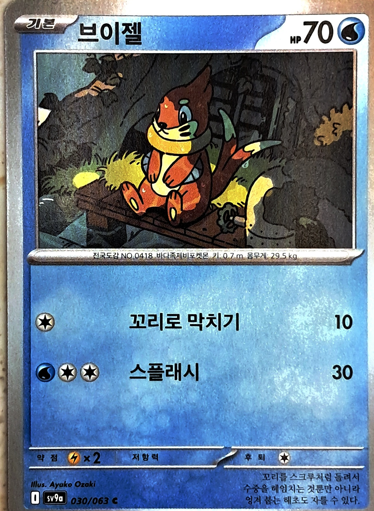

# 이미지 추적 최소 검증

이 문서는 카드·큐브 probe의 선행 검증 기록이다. 이후 [상품정보판·탭·재스캔 통합](PRODUCT-IMAGE-TRACKING.md)을 구현하고 EditMode 76/76을 통과했다. 새 통합은 빌드·설치·실물 시험을 수행하지 않았으며, 아래 probe APK의 기기 성과와 구분한다.

목표: 상품정보 기능을 연결하기 전에 **이미지의 3차원 위치·방향에 큐브가 붙는지** Galaxy A25에서 확인한다. 상품 인식·가격 조회·바코드 추종의 성공으로 해석하지 않는다.

2026-10-25 사용자 제공 카드 사진으로 참조 이미지를 교체하고 **51/51 자동 시험·Android 빌드·Galaxy A25 설치·실물 카드 FULL_TRACKING**을 확인했다. 사용자가 카메라 회전·거리 변화 중 카드 위 큐브 유지를 확인했다. 10회 반복·통제된 가림·장시간 시험은 아직 수행하지 않았다. [검증 기록](VALIDATION.md)과 [빌드·기기 검증 요약](validation/card-probe-2026-10-25.json)을 따른다. 앞선 강의 마커의 설치 기록은 별도 과거 결과다.

## 실행 구조

- 검증 씬: `Assets/Scenes/ImageTrackingProbe.unity`. 기존 `ProductAR.unity`와 기본 빌드 목록은 보존한다.
- `ARReadiness`가 기존 카메라 권한·AR 세션·100Hz 센서 요청 수명을 관리한다.
- `ARTrackedImageManager`가 참조 이미지 1개의 자세를 갱신한다. `ImageTrackingProbe`는 메인 스레드의 `LateUpdate`에서 그 자세를 큐브에 반영한다.
- ARCore의 `ArAugmentedImage_getTrackingMethod`가 **FULL_TRACKING(1)**인 동안만 표시한다. 마지막 위치만 남은 **LAST_KNOWN_POSE(2)**, 제한·소실, 확인 불가 상태에서는 숨긴다. 네이티브 포인터를 저장·해제하거나 작업 스레드로 넘기지 않는다.
- pause·비활성화 시 숨기고, 복귀 후 새 카메라 프레임과 유효한 추적 상태가 있어야 다시 표시한다.
- 별도 공간 앵커나 책상 Raycast를 만들지 않는다. 큐브는 이미지의 현재 자세를 따른다.

## 마커 준비



- 파일: `Assets/Images/test-card.jpg`, 참조 이미지 이름 `test-card`.
- 출처: 사용자가 프로젝트 루트에 제공한 `test.jpg`의 바이트 그대로인 복사본. 편집·보정은 하지 않았다. 기존 `lecture-control.jpg`는 보존하지만 현재 라이브러리에는 카드 1개만 등록한다.
- SHA-256: `4dca0d093e69a5b7208907d1a158d6f6d98cfaebfccd497831a9da39994b7813`.
- 2026-10-25 `arcoreimg eval-img`: **test.jpg 85점 / test2.jpg 40점**, 둘 다 exit 0. 공식 권장 기준 75점에 따라 `test2.jpg` 대신 사용자가 지정한 대체 이미지 `test.jpg`를 선택했다. 40점은 인식 불가능 판정이 아니며 품질 점수는 실기기 추적 성공을 보장하지 않는다.
- 실제 표시·출력 크기가 정해지지 않았으므로 Reference Image Library의 **Specify Size는 끈다**. ARCore가 크기를 추정하며 큐브도 추정 폭에 비례한다. 이 단계에서는 정확한 cm 단위 크기를 검증하지 않는다.
- 이번 실물 시험은 브이젤 카드를 사용했다. PC 화면에 사진을 띄우거나 평평한 판에 출력물을 붙이는 방법도 검증용으로 사용할 수 있다. 상품마다 추가 마커를 붙이는 최종 설계를 확정한 것은 아니다. 기존 바코드만 사용하는 확장은 [기술 조사 보고서](BARCODE-MARKER-RESEARCH.md)를 따른다.

## 빌드·기기 설치

```powershell
.\scripts\Build-ImageTrackingProbe.ps1
.\scripts\Install-Android.ps1 -DeviceSerial <serial> -ApkPath .\Builds\Android\ImageTrackingProbe.apk -Launch
```

검증 앱은 기존 앱과 같은 `com.yeonsik.midtermar`, versionName `0.1.1`, versionCode `2`를 사용한다. 이름은 **이미지 추적 검증**이다. 로컬 `.android/debug.keystore`를 명시해 서명하고, 설치 스크립트가 기기 인증서·버전을 다시 비교한 뒤 `-r` 업데이트한다. 서명이 다르면 중단하며 삭제·초기화하지 않는다.

빌드는 전용 영문 임시 폴더에서 수행한다. 원본의 상품 씬·Android 기본 설정을 검증용 설정으로 바꾸지 않는다. 새 씬·참조 이미지 라이브러리·재질과 GUID만 복사해 보존하고, 소스/빌드 입력 해시를 대조한다. 결과는 `artifacts/image-tracking-probe/`에 남긴다.

이번 카드 APK는 새 임시 캐시의 전체 초기 빌드를 중단한 뒤 기존 프로젝트 캐시를 사용해 생성했다. ProjectSettings 전체를 사전 백업하고 종료 후 복구했으며, 기존 상품 씬·주요 설정의 해시 일치를 확인했다. 빌드 **Succeeded / errors=0**, APK **62,265,590 bytes**, SHA-256 `a2b7772f9239c8fa5bd8811f435d45318209add078742958786b2a94e5ff9837`이다. APK와 원시 로그·기기 백업은 기존 Git 제외 규칙을 유지하고 위 검증 요약만 버전 관리한다.

실제 설치에서는 서명이 달라 기본 스크립트가 중단했다. 사용자 교체 설치 요청에 따라 기존 APK·데이터를 백업하고 새 APK를 설치했다. 외부 `files/il2cpp`는 앱이 자기 UID로 생성할 실행 캐시이므로 ADB 파일 복원 대상에서 제외해야 한다. 이번에 복원했던 shell 소유 캐시는 별도 이름으로 보존하고 새 캐시를 생성한 뒤 정상 초기화와 카드 추적을 확인했다. 기본 설치 스크립트가 임의 삭제하도록 변경하지 않았다.

## 사용자 실물 시험

1. 위 카드 사진 전체를 밝고 반사가 적은 상태로 비춘다. 사진이 화면에서 충분히 크게 보이도록 천천히 접근한다. 처음에는 참조 사진 자체를 화면에 띄우거나 출력해서 시험한다. 실물 카드는 촬영 당시의 원근·반사와 차이가 있으므로 별도 확인한다.
2. **추적 중** 문구와 파란 큐브가 사진 중앙에 나타나는지 확인한다.
3. 마커를 고정하고 휴대폰을 좌우로 이동한다. 큐브가 화면 중앙에 고정되지 않고 사진의 같은 위치에 남는지 확인한다.
4. 휴대폰을 고정하고 마커를 좌우·앞뒤로 옮기고 기울인다. 큐브의 위치·방향이 같이 변하는지 확인한다.
5. 사진을 완전히 가린다. 큐브가 이전 공간에 남지 않고 숨는지 확인한다. 다시 비추면 인식/재획득 횟수가 증가하며 표시돼야 한다.
6. Home으로 나갔다가 복귀한다. 새로 마커를 비추기 전 잘못된 위치에 큐브가 남는지 확인한다.

개발용 통과 목표는 동일 조건에서 10회 중 8회 이상 5초 내 인식, 잘못된 대상 표시 0회, 이동·회전·가림·재획득 동작 확인이다. 공식 채점 기준은 아니다. 앱 설치·세션 시작과 실제 마커 추적 결과는 분리해 기록한다.

## API 근거

- [AR Foundation 이미지 추적](https://docs.unity3d.com/Packages/com.unity.xr.arfoundation@6.3/manual/features/image-tracking.html)
- [ARCore 이미지 추적 방식과 마지막 자세](https://developers.google.com/ar/reference/c/group/ar-augmented-image)
- 로컬 ARCore 6.3.5 패키지 `Includes~/UnityXRNativePtrs.h`: `UnityXRNativeSession_1`, `UnityXRNativeImage_1`.
