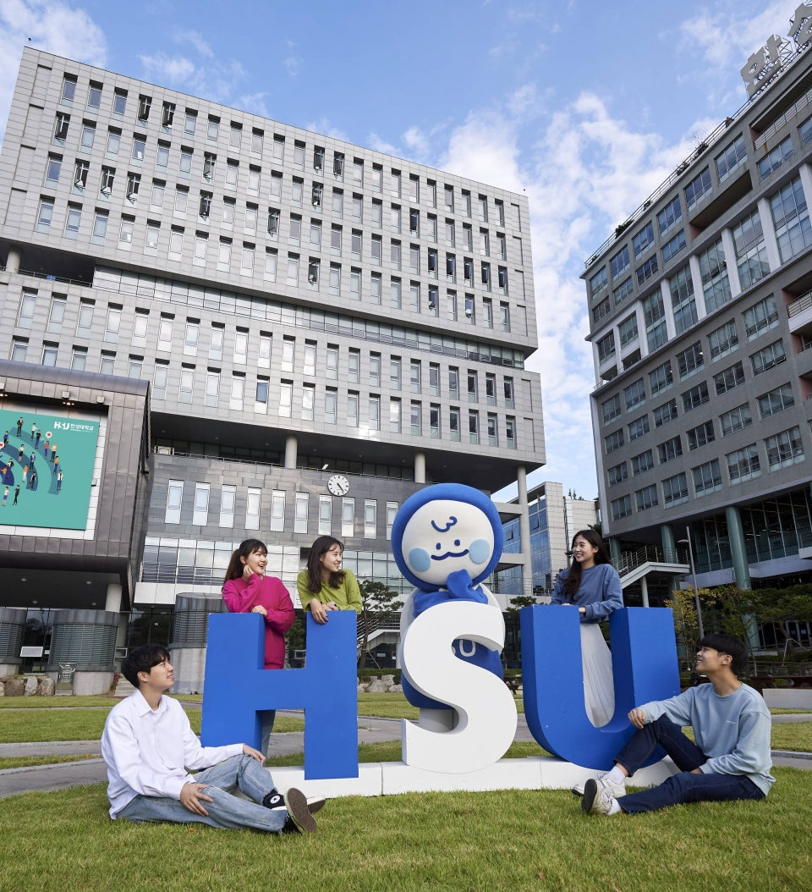

# 이미지 추적 최소 검증

목표: 상품정보 기능을 연결하기 전에 **이미지의 3차원 위치·방향에 큐브가 붙는지** Galaxy A25에서 확인한다. 상품 인식·가격 조회·바코드 추종의 성공으로 해석하지 않는다.

2026-10-25 현재 **51/51 자동 시험·Android 빌드·기존 앱 데이터 초기화 없는 호환 업데이트·실제 카메라 실행 확인**. 마커 실물 시험은 아직 수행하지 않았고, `SessionTracking`·이미지 `FULL_TRACKING`도 미확인이다. 상세 근거는 [검증 기록](VALIDATION.md)을 따른다.

## 실행 구조

- 검증 씬: `Assets/Scenes/ImageTrackingProbe.unity`. 기존 `ProductAR.unity`와 기본 빌드 목록은 보존한다.
- `ARReadiness`가 기존 카메라 권한·AR 세션·100Hz 센서 요청 수명을 관리한다.
- `ARTrackedImageManager`가 참조 이미지 1개의 자세를 갱신한다. `ImageTrackingProbe`는 메인 스레드의 `LateUpdate`에서 그 자세를 큐브에 반영한다.
- ARCore의 `ArAugmentedImage_getTrackingMethod`가 **FULL_TRACKING(1)**인 동안만 표시한다. 마지막 위치만 남은 **LAST_KNOWN_POSE(2)**, 제한·소실, 확인 불가 상태에서는 숨긴다. 네이티브 포인터를 저장·해제하거나 작업 스레드로 넘기지 않는다.
- pause·비활성화 시 숨기고, 복귀 후 새 카메라 프레임과 유효한 추적 상태가 있어야 다시 표시한다.
- 별도 공간 앵커나 책상 Raycast를 만들지 않는다. 큐브는 이미지의 현재 자세를 따른다.

## 마커 준비



- 파일: `Assets/Images/lecture-control.jpg`.
- 출처: 사용자가 제공한 `lecture/Chap4-Resources.zip`의 `Target-Hansung.jpg`. `Media-Package.zip`에도 동일 이미지가 있다. 강의 실습·로컬 과제 검증용이며 공개 재배포 권한은 확인하지 않았다.
- SHA-256: `8863d11f2fccb98b201091ccf48b0484d5cd7ede62a4cb13e386a451528ffcae`. 강의 이미지와 복사본의 바이트가 동일하다. 생성형 편집·보정은 하지 않았다.
- 2026-10-25 `arcoreimg eval-img` **80점 / exit 0**. 품질 점수는 실기기 추적 성공이 아니다.
- 실제 표시·출력 크기가 정해지지 않았으므로 Reference Image Library의 **Specify Size는 끈다**. ARCore가 크기를 추정하며 큐브도 추정 폭에 비례한다. 이 단계에서는 정확한 cm 단위 크기를 검증하지 않는다.
- 최초 인식 확인은 PC 화면에 사진을 크게 띄워 수행할 수 있다. 상품의 이동·회전 시험은 사진을 출력해 평평하고 단단한 판에 붙이고 상품과 함께 움직이도록 고정한다. 별도 마커를 허용하는 검증이며 자연 포장 인식을 증명하지 않는다.

## 빌드·기기 설치

```powershell
.\scripts\Build-ImageTrackingProbe.ps1
.\scripts\Install-Android.ps1 -DeviceSerial <serial> -ApkPath .\Builds\Android\ImageTrackingProbe.apk -Launch
```

검증 앱은 기존 앱과 같은 `com.yeonsik.midtermar`, versionName `0.1.1`, versionCode `2`를 사용한다. 이름은 **이미지 추적 검증**이다. 로컬 `.android/debug.keystore`를 명시해 서명하고, 설치 스크립트가 기기 인증서·버전을 다시 비교한 뒤 `-r` 업데이트한다. 서명이 다르면 중단하며 삭제·초기화하지 않는다.

빌드는 전용 영문 임시 폴더에서 수행한다. 원본의 상품 씬·Android 기본 설정을 검증용 설정으로 바꾸지 않는다. 새 씬·참조 이미지 라이브러리·재질과 GUID만 복사해 보존하고, 소스/빌드 입력 해시를 대조한다. 결과는 `artifacts/image-tracking-probe/`에 남긴다.

## 사용자 실물 시험

1. HSU 사진 전체를 밝고 반사가 적은 상태로 비춘다. 사진이 화면에서 충분히 크게 보이도록 천천히 접근한다.
2. **추적 중** 문구와 파란 큐브가 사진 중앙에 나타나는지 확인한다.
3. 마커를 고정하고 휴대폰을 좌우로 이동한다. 큐브가 화면 중앙에 고정되지 않고 사진의 같은 위치에 남는지 확인한다.
4. 휴대폰을 고정하고 마커를 좌우·앞뒤로 옮기고 기울인다. 큐브의 위치·방향이 같이 변하는지 확인한다.
5. 사진을 완전히 가린다. 큐브가 이전 공간에 남지 않고 숨는지 확인한다. 다시 비추면 인식/재획득 횟수가 증가하며 표시돼야 한다.
6. Home으로 나갔다가 복귀한다. 새로 마커를 비추기 전 잘못된 위치에 큐브가 남는지 확인한다.

개발용 통과 목표는 동일 조건에서 10회 중 8회 이상 5초 내 인식, 잘못된 대상 표시 0회, 이동·회전·가림·재획득 동작 확인이다. 공식 채점 기준은 아니다. 앱 설치·세션 시작과 실제 마커 추적 결과는 분리해 기록한다.

## API 근거

- [AR Foundation 이미지 추적](https://docs.unity3d.com/Packages/com.unity.xr.arfoundation@6.3/manual/features/image-tracking.html)
- [ARCore 이미지 추적 방식과 마지막 자세](https://developers.google.com/ar/reference/c/group/ar-augmented-image)
- 로컬 ARCore 6.3.5 패키지 `Includes~/UnityXRNativePtrs.h`: `UnityXRNativeSession_1`, `UnityXRNativeImage_1`.
